

<picture>
  <source media="(prefers-color-scheme: dark)" srcset="images/logo-white.png">
  
</picture>

<h3>Движок для создания 2D игр — от идеи до готовой игры для браузера, Windows и Android</h3>

[Возможности](#возможности) · [Что нового](#что-нового) · [Скриншоты](#скриншоты) · [Установка](#установка) · [Лицензия](#лицензия)

 

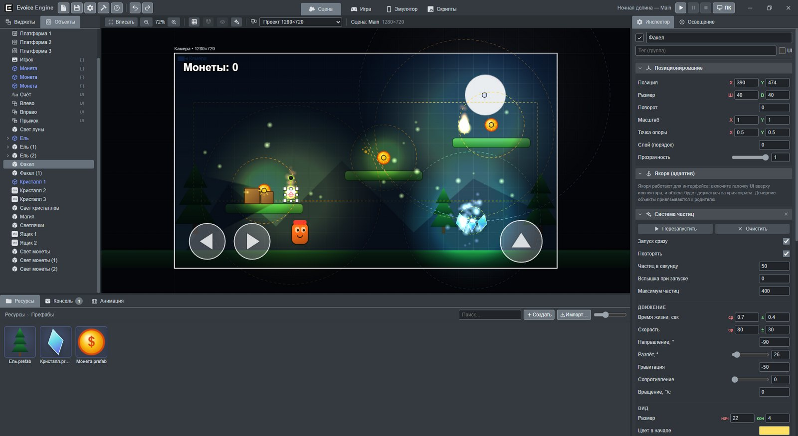

 

## О проекте

**Evoice Engine** — визуальный редактор и движок для 2D игр в духе Unity, но проще. Собирайте сцену из готовых виджетов и префабов, программируйте блоками, как в Scratch, или пишите код на JavaScript и Python. Проверяйте игру на эмуляторе телефона или прямо на своём Android-телефоне через приложение Evoice Remote и собирайте её одной кнопкой для Яндекс Игр, Windows или Android.

> Здесь публикуются установщики, приложение Evoice Remote и описания версий. Исходный код движка закрыт.

## Возможности

<table>
<tr>
<td width="50%" valign="top">

### 🎬 Редактор в стиле Unity
Сцена, дерево объектов, инспектор, ресурсы, отмена и повтор. Якоря и адаптив под любые экраны, предпросмотр разных разрешений. Перетаскивание файлов прямо из проводника и ресурсов прямо в инспектор.

</td>
<td width="50%" valign="top">

### 🧩 Три способа программировать
Блоки как в Scratch, JavaScript и Python с подсказками в редакторе. Глобальные переменные, скрипты сцены, доступ к переменным других скриптов. Списки, типы данных, функции.

</td>
</tr>
<tr>
<td valign="top">

### 📦 Префабы
Готовый объект со всеми компонентами, скриптами и дочерними объектами сохраняется в «Ресурсы» и ставится на любые сцены. Одна правка префаба обновляет все его копии во всех сценах.

</td>
<td valign="top">

### 🎥 Камера и постобработка
Камера — виджет на сцене: следование за игроком, плавность, границы. Виньетка, зерно, цвет, свечение, размытие, пикселизация и готовые наборы «Кино», «Ретро», «Ночь», «Ужас».

</td>
</tr>
<tr>
<td valign="top">

### 🕹️ Готовое управление
Платформер, вид сверху, раннер или корабль — одним компонентом. Клавиатура, экранный джойстик и геймпад Xbox с вибрацией работают сразу.

</td>
<td valign="top">

### 📱 Эмулятор и свой телефон
Популярные модели, портретная и альбомная ориентация, наклон, встряска, вибрация. А с приложением **Evoice Remote** игра запускается на вашем телефоне с настоящими датчиками.

</td>
</tr>
<tr>
<td valign="top">

### ⚙️ Физика и триггеры
Rigidbody 2D и Collider 2D на Box2D, упругость, трение и заморозка осей, триггер-зоны с событиями «вошёл» и «вышел».

</td>
<td valign="top">

### ✨ Частицы и освещение
Огонь, дым, искры, взрыв, магия, снег и дождь. 2D-освещение: точечный свет, прожекторы, общий свет, тени и мерцание.

</td>
</tr>
<tr>
<td valign="top">

### 🎞️ Анимация, атласы и видео
Таймлайн с ключевыми кадрами, 18 готовых плавностей и режим записи. Атласы спрайтов с именованными анимациями, виджет «Видео» для MP4 и WebM.

</td>
<td valign="top">

### 🔊 Звук
Музыка и эффекты, пространственный звук, эхо, реверберация, фильтры и готовые наборы: пещера, под водой, рация.

</td>
</tr>
<tr>
<td valign="top">

### 🚀 Сборка одной кнопкой
HTML5 и Яндекс Игры, Windows `.exe`, Android `.apk` без Android Studio — нужные компоненты ставятся прямо из движка. Система сохранений с облаком Яндекс Игр.

</td>
<td valign="top">

### 🗂️ Менеджер проектов
Проекты с картинкой сцены, поиск и фильтры, документация с поиском. Новые версии движок находит и ставит сам.

</td>
</tr>
</table>

Полный список изменений каждой версии — на странице **[Releases](https://github.com/Evoice-dev/Evoice-Engine-Releases/releases)**.

## Что нового

### 📱 Evoice Remote — игра на своём телефоне

<table>
<tr>
<td width="28%" align="center">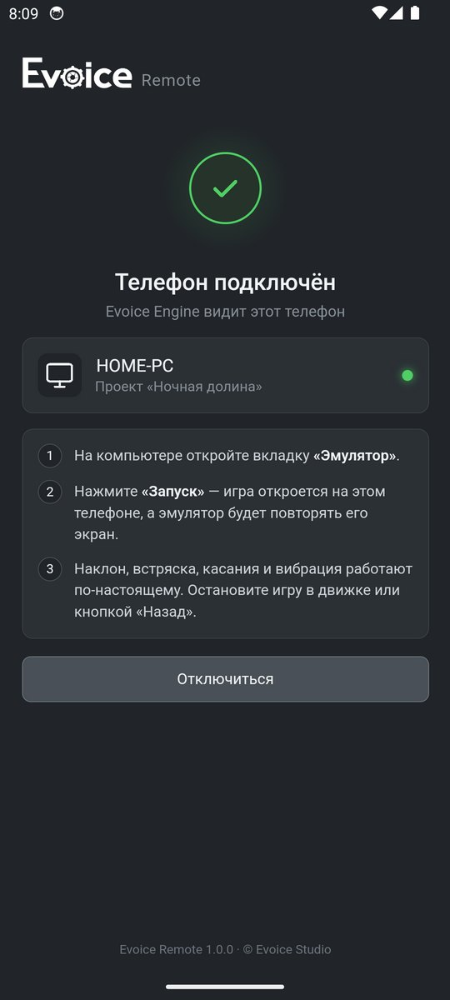</td>
<td width="72%">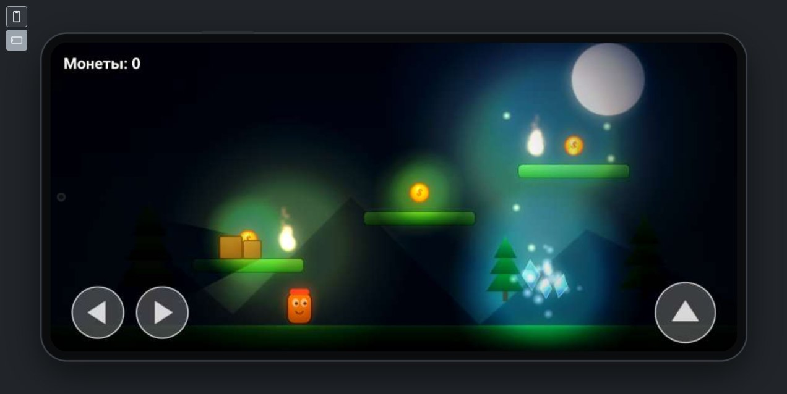
Игра идёт на телефоне, а вкладка «Эмулятор» повторяет его экран
</td>
</tr>
</table>

Приложение для Android превращает ваш телефон в экран эмулятора. Нажмите «Запуск» на вкладке «Эмулятор» — игра откроется на телефоне, а движок покажет его экран.

- Наклон, встряска, компас, касания несколькими пальцами и вибрация работают от настоящих датчиков.
- Мышью и клавиатурой в эмуляторе тоже можно играть, сообщения и ошибки игры приходят в консоль движка.
- Телефон и компьютер должны быть в одной сети Wi-Fi: приложение само находит компьютер с открытым проектом, а движок показывает уведомление о подключении.
- Файл **`Evoice-Remote.apk`** приложен к каждому релизу. Его можно поставить и из движка: вкладка «Эмулятор» → «Телефон» → «Установить по USB».

### 🎥 Камера и постобработка

<table>
<tr>
<td width="50%">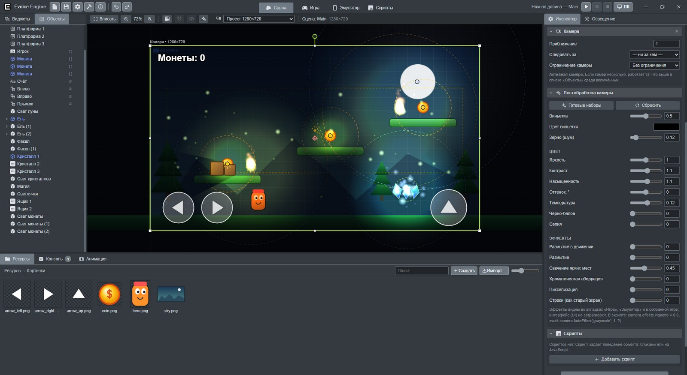
<b>Камера</b> — рамка на сцене это кадр игры, эффекты настраиваются в Инспекторе
</td>
<td width="50%">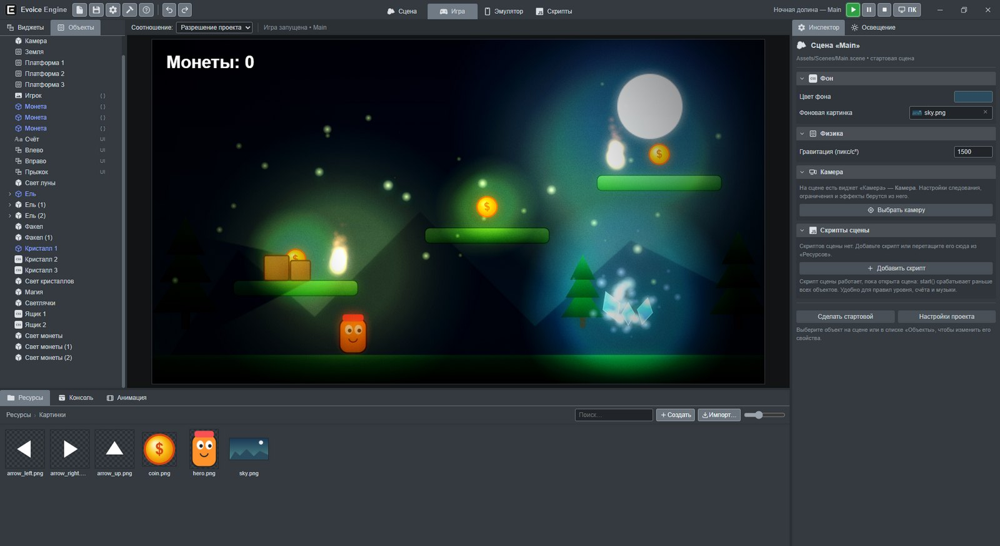
Та же сцена в игре: <b>виньетка, свечение и зерно</b> поверх освещения
</td>
</tr>
</table>

Камера — отдельный виджет: следует за объектом по обеим осям или только по одной, держит цель в нужной точке экрана, плавно догоняет и не выходит за границы уровня. Постобработка накладывается на изображение камеры: виньетка, зерно, яркость, контраст, насыщенность, температура, чёрно-белое, сепия, размытие и размытие в движении, свечение, хроматическая аберрация, пикселизация и строки старого экрана. Готовые наборы — «Кино», «Ретро», «Ночь», «Сон», «Ужас», «Старый телевизор» и другие. Интерфейс игры эффекты не затрагивают.

### 📦 Префабы и 🕹️ готовое управление

<table>
<tr>
<td width="50%">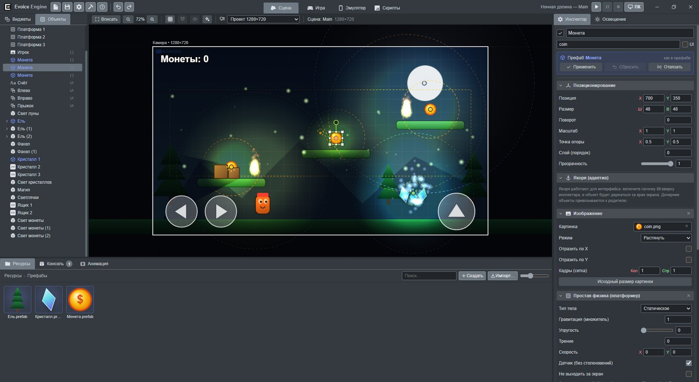
<b>Префабы</b>: копии отмечены синим кубиком, «Применить» обновляет все копии
</td>
<td width="50%">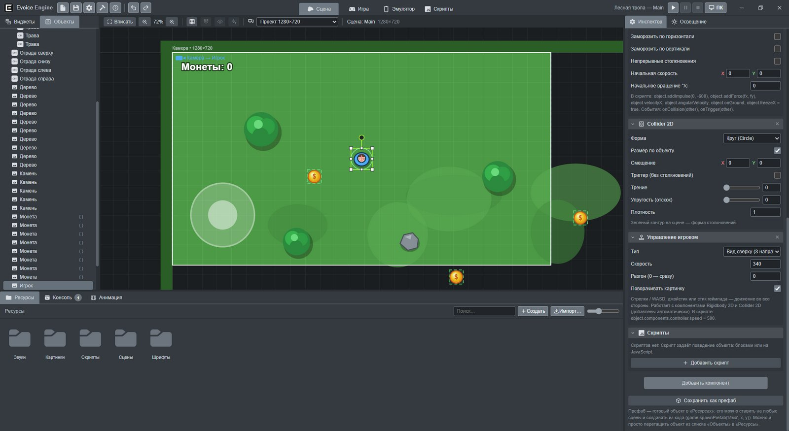
<b>Управление игроком</b> в шаблоне «Вид сверху»: стрелки, WASD, джойстик и геймпад
</td>
</tr>
</table>

- **Префабы.** Настройте объект на сцене и перетащите его из списка «Объекты» в «Ресурсы» — получится префаб с превью. Поставьте его на любую сцену перетаскиванием или двойным щелчком. «Применить» обновляет префаб и все копии во всех сценах, «Сбросить» возвращает копию к префабу, «Отвязать» делает её обычным объектом. В коде — `game.spawnPrefab('Враг', x, y)`, в блоках — «создать префаб».
- **Управление игроком** (Инспектор → «Добавить компонент»): платформер, вид сверху на 8 или 4 направления, раннер, корабль. Скорость, прыжок, двойной прыжок и разгон настраиваются в Инспекторе, нужная физика добавляется сама. Новый шаблон проекта — **«Вид сверху»**.
- **Геймпад Xbox**: кнопки, стики, курки и вибрация — блоками и в коде.

### 🎞️ Анимация

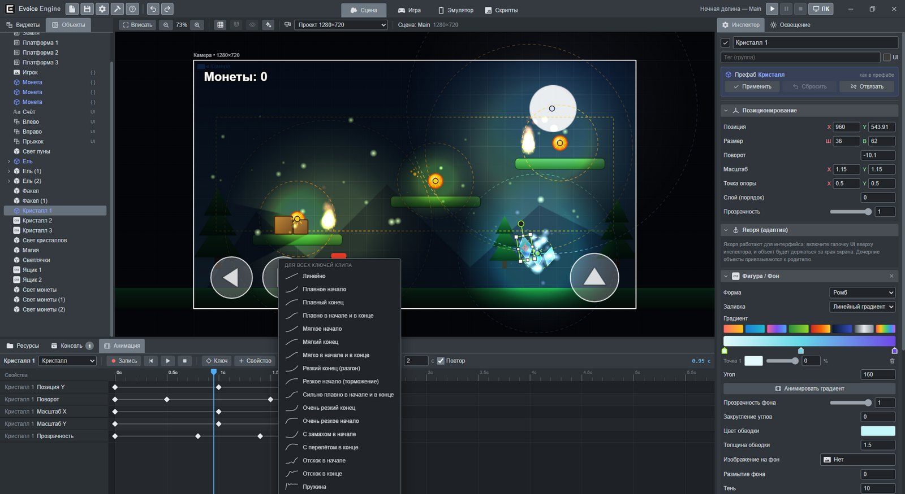

<b>Таймлайн</b> с ключевыми кадрами и меню плавностей: у каждой — график кривой

18 готовых плавностей — от линейной до отскока и пружины, «Отзеркалить» клип задом наперёд, по горизонтали или по вертикали. Атлас спрайта: поля и промежутки между кадрами, диапазон кадров, режим «туда-обратно» и именованные анимации. Виджет «Видео» (MP4, WebM), свой курсор мыши, выход из игры блоком и командой `game.quit()`.

### 🗂️ Менеджер проектов и автообновление

<table>
<tr>
<td width="50%">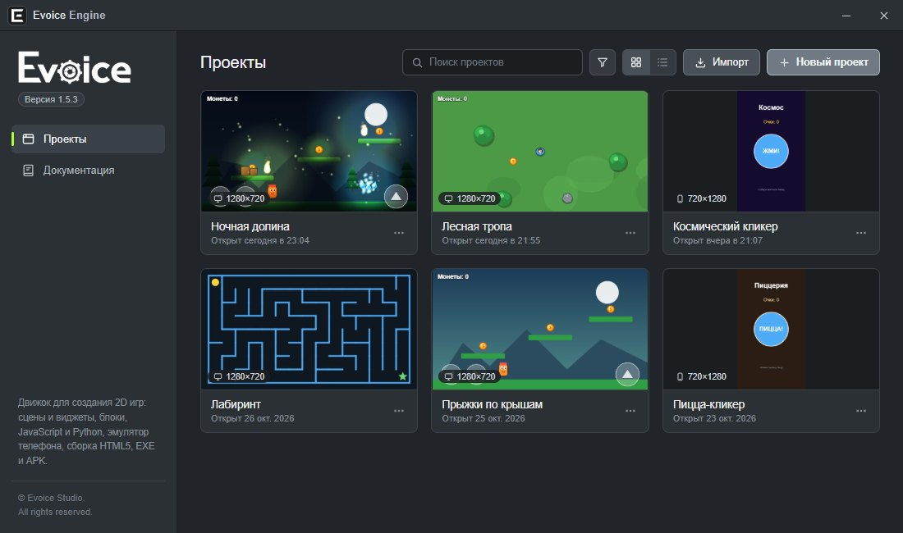
<b>Менеджер проектов</b> — отдельное окно с картинками сцен
</td>
<td width="50%">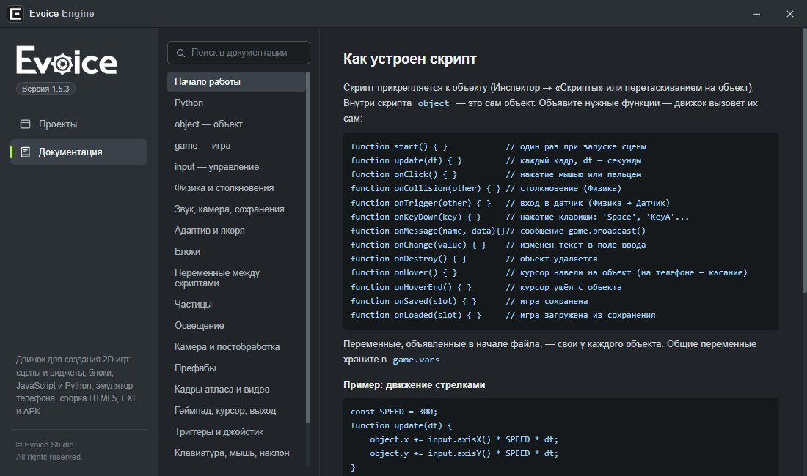
<b>Документация</b> по API, блокам и Python с поиском
</td>
</tr>
</table>

Проекты показываются с картинкой стартовой сцены и размером экрана. Есть поиск, фильтр по ориентации, вид сеткой или списком, импорт перетаскиванием папки. Новые версии движок находит сам: в менеджере проектов появляется кнопка «Обновить». Обновление скачивается из движка, проверяется подпись Evoice Studio, проекты остаются на месте.

## Скриншоты

### 🎬 Сцена, свет и фигуры

<table>
<tr>
<td width="50%">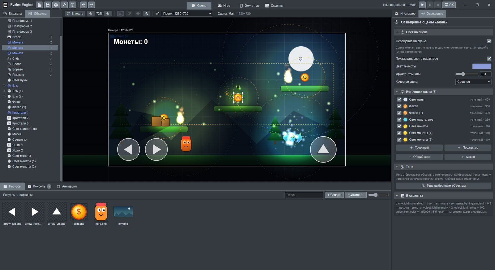
<b>Освещение</b> — общий свет, тени и мерцание видны прямо в редакторе
</td>
<td width="50%">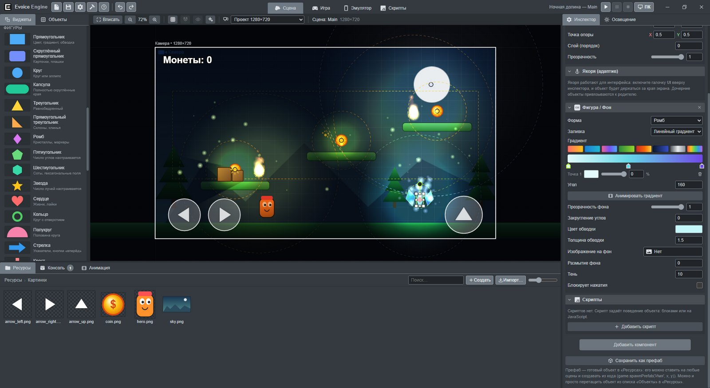
<b>Фигуры и градиенты</b> — 16 готовых примитивов, обводка, тень и закругления
</td>
</tr>
</table>

### 🧩 Блоки, JavaScript и Python

<table>
<tr>
<td width="50%">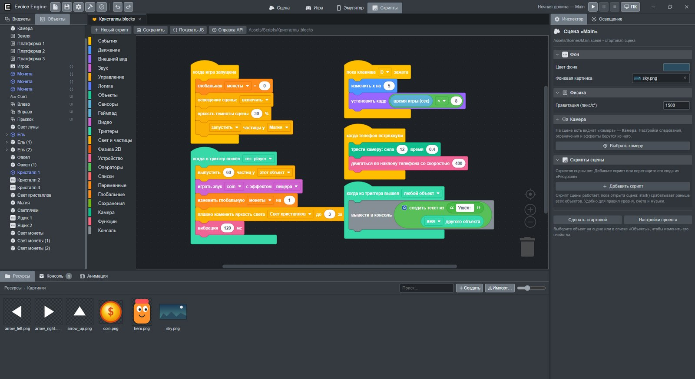
<b>Блоки</b> в стиле Scratch: триггеры, глобальные переменные, звук с эффектами
</td>
<td width="50%">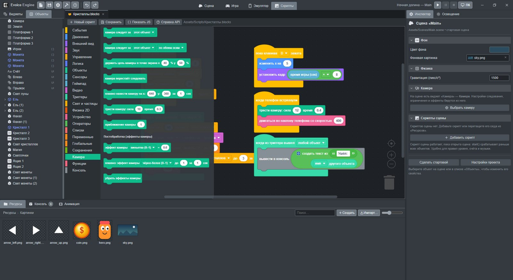
Категории блоков — например, <b>«Камера»</b> с эффектами
</td>
</tr>
<tr>
<td>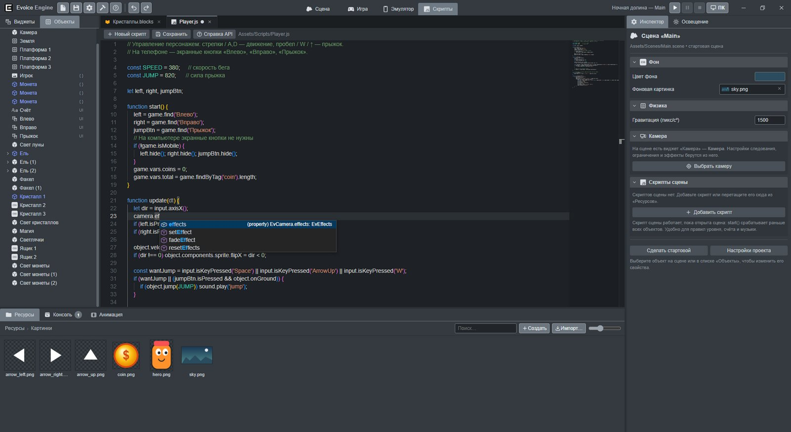
<b>JavaScript</b> с автодополнением по всему API движка
</td>
<td>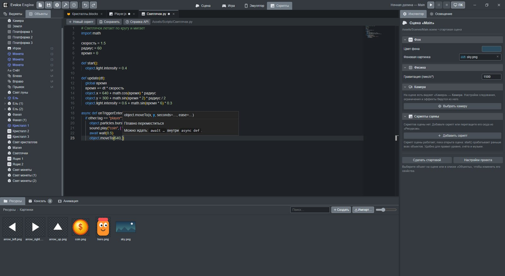
<b>Python</b> с подсказками параметров и описанием функций
</td>
</tr>
</table>

### 📱 Эмулятор и сборка

<table>
<tr>
<td width="60%">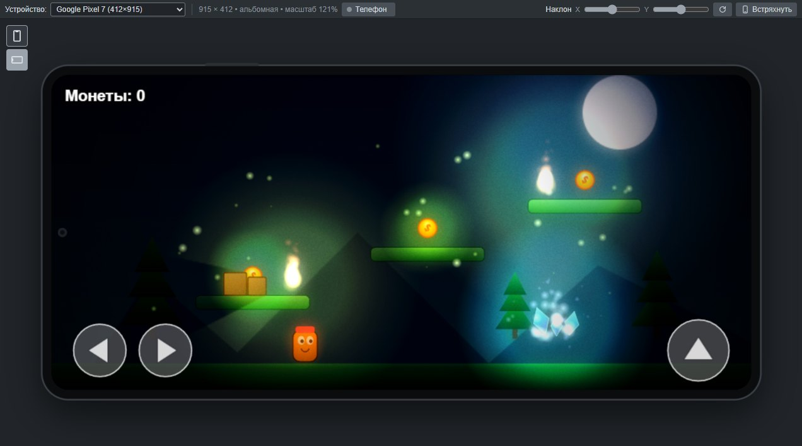
<b>Эмулятор</b> Google Pixel 7 в альбомной ориентации — с наклоном, встряской и экранными кнопками
</td>
<td width="40%" rowspan="2" align="center">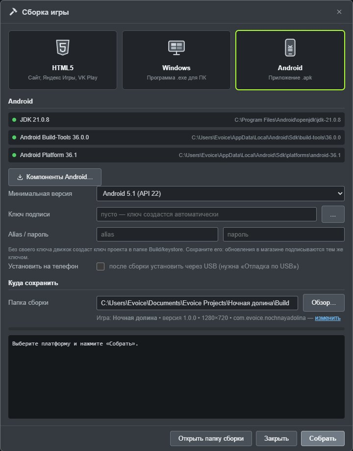
<b>Сборка</b> для HTML5, Windows и Android — компоненты Android ставятся из движка
</td>
</tr>
<tr>
<td align="center">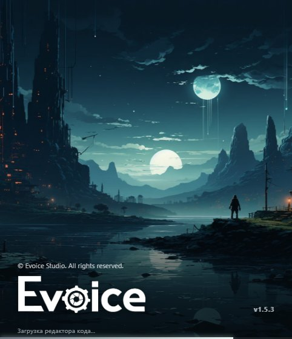
Заставка при запуске
</td>
</tr>
</table>

## Установка

1. Откройте **[последний релиз](https://github.com/Evoice-dev/Evoice-Engine-Releases/releases/latest)** и скачайте в разделе **Assets** файл **`Evoice-Engine-Setup-<версия>.exe`**.
2. Запустите установщик и следуйте шагам — ярлык появится на рабочем столе и в меню «Пуск».
3. Если Windows покажет окно «Система Windows защитила ваш компьютер», нажмите **«Подробнее» → «Выполнить в любом случае»**: установщик пока не подписан сертификатом.

Дальше движок обновляется сам: когда выходит новая версия, в менеджере проектов появляется кнопка «Обновить».

Чтобы запускать игры на своём телефоне, установите на него **`Evoice-Remote.apk`** из того же релиза или из движка: вкладка «Эмулятор» → «Телефон».

| Системные требования | |
|---|---|
| Система | Windows 10 или 11, 64-бит |
| Место на диске | около 500 МБ |
| Сборка игр для Android | интернет при первой установке компонентов (около 300 МБ, ставятся из движка) |
| Evoice Remote | телефон на Android 7.0 или новее в одной сети Wi-Fi с компьютером |

После запуска откроется менеджер проектов — нажмите «Новый проект» и выберите шаблон «Платформер», «Вид сверху», «Кликер» или «Пустой проект». Документация открывается в менеджере проектов (раздел «Документация») и в движке клавишей <kbd>F1</kbd>, руководство пользователя лежит в папке программы.

## Лицензия

**Evoice Engine** — проприетарное программное обеспечение. © 2026 Evoice Studio. Все права защищены.

Движок распространяется бесплатно на условиях **[лицензионного соглашения](EULA.txt)**. Игры, созданные в Evoice Engine, принадлежат их авторам — их можно публиковать и продавать.

Движок использует библиотеки с открытым исходным кодом (Electron, Blockly, Monaco Editor, planck.js, Brython и другие); их лицензии лежат в файле `THIRD_PARTY_LICENSES.txt` в папке программы.

 
Сделано в <b>Evoice Studio</b>

